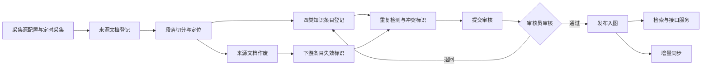
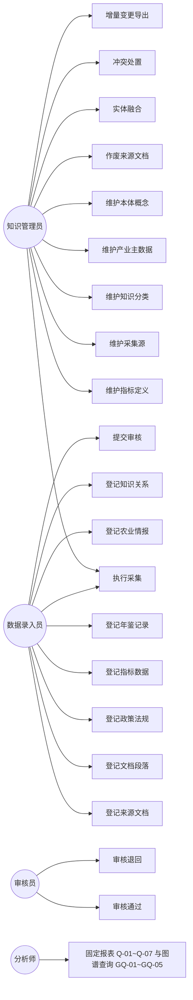
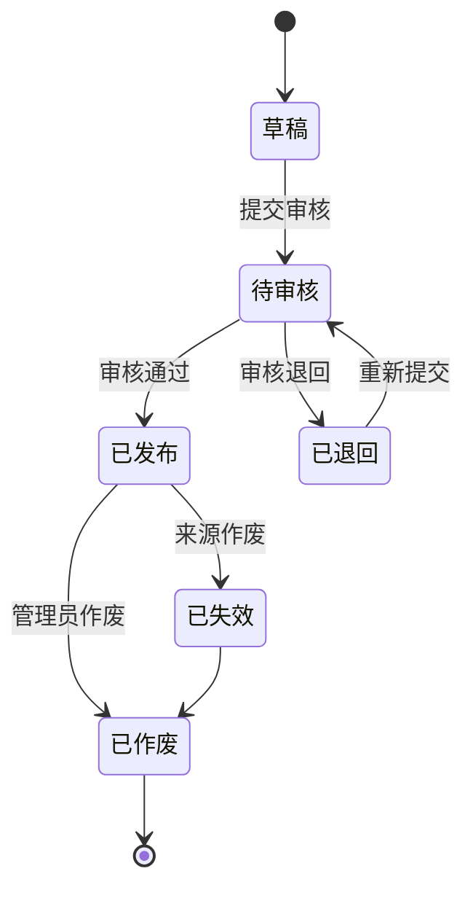
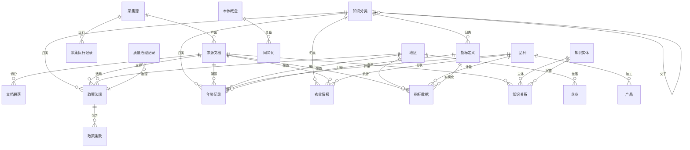
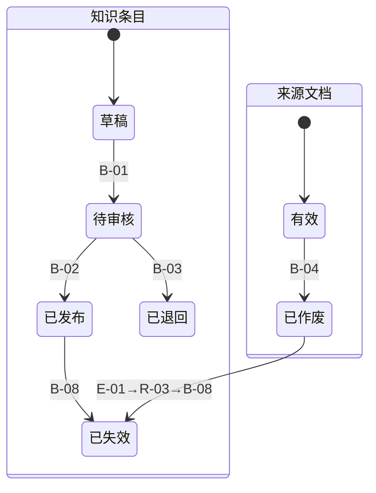
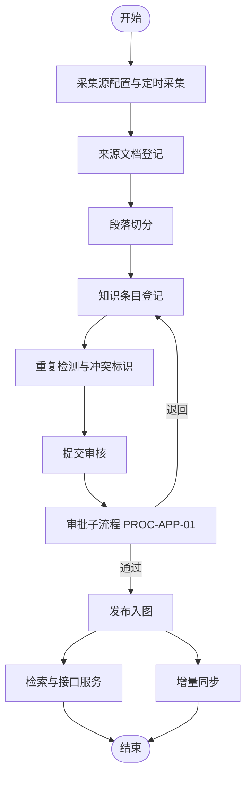
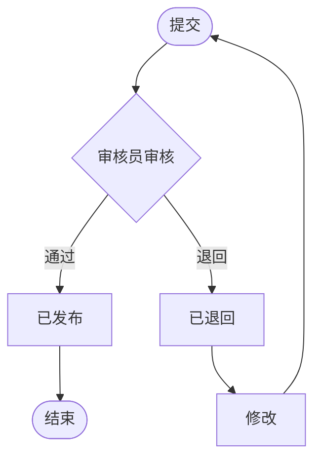

# 粮油产业多维知识图谱 软件需求文档

| 项目 | 内容 |
|---|---|
| 文档名称 | 粮油产业多维知识图谱软件需求文档 |
| 版本 | V1.5（生产级·知识图谱系统目标纠偏） |
| 编制依据 | 《软件需求编写规范 V4.0》《AI 需求探索与确认提示词 V4.0》 |
| 文档状态 | 完整（附录 B 待确认项 0 项，可重新进入本体建模） |
| 目标系统 | 粮油产业多维知识图谱系统（Knowledge Graph System for Grain & Oil Industry） |

---

## 第一部分 项目概述与范围

### 1.1 项目背景与目标

[已确认] 本项目的总体目标是建成一套面向粮油产业的生产级知识图谱系统。系统以真实业务实体及其关系网络为核心，完成政策法规、农业经济、行业年鉴与全球农业情报的归集、治理、知识构建、融合与语义化组织，并提供图数据存储、图谱检索、关系展开、图谱可视化、来源回溯、质量治理、增量更新和接口服务。本体 YAML、录入表单、SQLite 联调引擎及本体模型可视化均只是建设或治理工具，不是项目目标，也不能替代知识图谱系统交付。

建设目标（可验证）：

| 编号 | 目标 | 验证方式 |
|---|---|---|
| G-01 | 建成 1 套生产级知识图谱系统，实际承载业务实体与关系，提供图数据存储、实体检索、关系展开、图谱可视化、来源回溯、增量更新与接口调用 | 端到端系统验收；仅交付本体文件、静态模型图、领域技能包或 CRUD 表单均判定不通过 |
| G-02 | 覆盖政策法规、农业经济、行业年鉴、全球农业情报四大类内容 | 分类目录、本体配置记录、验收记录 |
| G-03 | 知识来源可回溯至来源文档及段落位置 | 抽样回溯记录（100 条抽样全部命中） |
| G-04 | 具备重复检测、实体融合与冲突标识能力 | 治理记录、检测报告 |
| G-05 | 标准功能测试用例通过率 100%，常用查询 P95 响应 ≤ 3 秒 | 功能/性能测试报告 |
| G-06 | 具备增量更新能力，并完成不少于 1 次增量更新验收 | 更新日志、验收记录 |
| G-07 | 支持按配置从公开情报页面自动采集，采集产物自动登记为来源文档并切分到段落级 | 采集运行日志、采集记录清单、抽样核对 |
| G-08 | 建立三轴知识体系（知识分类树 + 产业环节 + 要素维度），知识条目按分类目录组织 | 分类目录、体系覆盖率报表、抽样核对 |

### 1.2 业务范围

**范围内**：四类知识（政策法规、农业经济、行业年鉴、全球农业情报）的**网页采集与离线文件登记**、结构化知识构建（含抽取结果接入、实体对齐与关系生成）、图数据存储与发布、业务图谱检索与可视化、来源追溯、质量治理、发布审核、增量更新及接口服务。

**范围外**：原始文档的 OCR/版式还原算法研发、外部数据源的商务采购、面向公众的门户网站设计、模型训练本身。

**系统交付边界**：最终交付物必须是可部署、可访问、可执行完整知识业务流程的知识图谱系统，而非领域技能包、对象 CRUD 应用或录入表单集合。录入表单仅作为知识采集与治理的辅助功能；仅展示本体模型结构的静态 `知识图谱.html` 不属于业务知识图谱可视化验收成果。

**采集边界**：仅采集公开可访问的 HTTPS/HTTP 页面，不绕过登录、付费墙与验证码；不采集内网、回环与云元数据地址（SSRF 防护见 R-11）；采集留痕含 URL、抓取时间、HTTP 状态、页面快照哈希与 UA 标识。

**外部边界**：上游数据源（政府网站、统计机构、行业出版物、国际组织）以**采集任务自动获取**或离线文件方式提供；下游消费方为粮油全产业链平台与垂直领域AI模型，通过本系统对外接口获取知识。

### 1.3 业务域划分

| 业务域 | 职责 | 主要对象 |
|---|---|---|
| 知识采集域 | 采集源配置与调度、网页抓取与留痕、来源文档登记、段落切分与定位 | 采集源、采集执行记录、来源文档、文档段落 |
| 政策法规域 | 政策文件与条款的结构化组织 | 政策法规、政策条款 |
| 农业经济域 | 指标口径定义与指标值管理 | 指标定义、指标数据 |
| 行业年鉴域 | 年鉴条目登记与统计口径对齐 | 年鉴记录 |
| 全球情报域 | 全球产能、产量、贸易与市场情报 | 农业情报 |
| 产业主数据域 | 品种、产品、地区、企业主数据 | 品种、产品、地区、企业 |
| 本体语义域 | 概念、同义词与关系三元组 | 本体概念、同义词、知识关系 |
| 知识体系域 | 知识分类树、产业环节与要素维度维护 | 知识分类 |
| 质量治理域 | 重复检测、实体融合、冲突标识 | 质量治理记录 |
| 审核发布域 | 知识条目一级审核与发布 | 状态机与审核流程 |

### 1.4 端到端业务流程全景



### 1.5 核心清单总览

| 类别 | 清单 |
|---|---|
| 业务对象 | 采集源、采集执行记录、知识分类、来源文档、文档段落、政策法规、政策条款、指标定义、指标数据、年鉴记录、农业情报、品种、产品、地区、企业、本体概念、同义词、知识关系、质量治理记录 |
| 业务功能 | FUNC-01 ~ FUNC-13，B-01 ~ B-09，Q-01 ~ Q-07 |
| 跨对象事件 | E-01 ~ E-09 |
| 事件协同场景 | SCN-01 来源作废失效传播、SCN-02 实体融合引用改挂 |
| 端到端流程 | PROC-01 知识入库到发布协同流 |
| 审批流 | PROC-APP-01 知识发布一级审核流 |
| 查询报表 | REP-01 ~ REP-07 |
| 角色 | ROLE-01 知识管理员、ROLE-02 数据录入员、ROLE-03 审核员、ROLE-04 分析师 |
| 接口 | INT-01 图谱检索、INT-02 实体详情、INT-03 来源回溯、INT-04 增量同步、INT-05 采集触发 |

### 1.6 角色总览

| 编号 | 角色 | 类型 | 职责 |
|---|---|---|---|
| ROLE-01 | 知识管理员 | 内部操作角色 | 主数据、本体、知识体系、治理、审核规则、采集源配置与全量权限 |
| ROLE-02 | 数据录入员 | 内部操作角色 | 执行采集、来源文档与四类知识条目登记、提交审核 |
| ROLE-03 | 审核员 | 内部审批角色 | 知识条目审核通过/退回 |
| ROLE-04 | 分析师 | 内部查询角色 | 报表查询与接口消费 |

---

## 第二部分 业务功能与规则

### 2.1 业务功能清单与角色-功能业务用例图

| 编号 | 功能 | 主操作对象 | 执行角色 |
|---|---|---|---|
| FUNC-01 | 登记来源文档 | 来源文档 | ROLE-02 |
| FUNC-02 | 登记来源文档段落 | 文档段落 | ROLE-02 |
| FUNC-03 | 登记政策法规及条款 | 政策法规/政策条款 | ROLE-02 |
| FUNC-04 | 维护指标定义 | 指标定义 | ROLE-01 |
| FUNC-05 | 登记指标数据（含重复检测） | 指标数据 | ROLE-02 |
| FUNC-06 | 登记年鉴记录 | 年鉴记录 | ROLE-02 |
| FUNC-07 | 登记全球农业情报 | 农业情报 | ROLE-02 |
| FUNC-08 | 维护产业主数据 | 品种/产品/地区/企业 | ROLE-01 |
| FUNC-09 | 维护本体概念与同义词 | 本体概念/同义词 | ROLE-01 |
| FUNC-10 | 登记知识关系三元组 | 知识关系 | ROLE-02 |
| FUNC-11 | 维护采集源（新增/修改/启停/删除） | 采集源 | ROLE-01 |
| FUNC-12 | 执行采集并登记来源文档与段落 | 采集源/采集执行记录/来源文档/文档段落 | ROLE-01、ROLE-02 |
| FUNC-13 | 维护知识分类体系（分类树、产业环节、要素维度） | 知识分类 | ROLE-01 |
| B-01 | 提交审核 | 四类知识条目/知识关系 | ROLE-02 |
| B-02 | 审核通过并发布 | 同上 | ROLE-03 |
| B-03 | 审核退回 | 同上 | ROLE-03 |
| B-04 | 作废来源文档 | 来源文档 | ROLE-01 |
| B-05 | 实体融合 | 质量治理记录 | ROLE-01 |
| B-06 | 冲突处置 | 质量治理记录 | ROLE-01 |
| B-07 | 增量变更导出 | 全模型 | ROLE-01 |
| B-08 | 标记下游条目失效 | 四类知识条目/知识关系 | 系统自动 |
| B-09 | 启停采集源 | 采集源 | ROLE-01 |
| Q-01~Q-07 | 七类查询报表 | 多对象 | ROLE-04 |



### 2.2 关键功能详述

**FUNC-05 登记指标数据**

| 项 | 内容 |
|---|---|
| 操作角色 | ROLE-02 数据录入员 |
| 主操作对象 | 指标数据 |
| 前置条件 | 指标定义已存在且状态为"有效"；地区、品种主数据存在；来源文档状态为"有效" |
| 操作步骤 | 选择指标→选择地区→选择品种→填写期间与数值→选择来源文档与段落→保存 |
| 涉及规则 | REF-02、INV-03、R-02 |
| 后置状态变更 | 新增指标数据，状态=草稿；若命中重复则生成质量治理记录（重复） |
| 下游触发 | 无（提交审核由 B-01 显式触发） |

**FUNC-12 执行采集并登记来源文档与段落**

| 项 | 内容 |
|---|---|
| 操作角色 | ROLE-01、ROLE-02 |
| 主操作对象 | 采集源、采集执行记录、来源文档、文档段落 |
| 前置条件 | 采集源状态=启用；URL 通过 R-11 校验；当期未被同快照哈希去重拦截 |
| 操作步骤 | 调度触发或手动执行→发起请求（带 UA、超时、重试）→保存页面快照至 MinIO→计算 SHA-256→按 R-09 去重→登记来源文档（标题、发布机构、发布日期、语种、页数、checksum）→HTML 正文提取→按标题/段落切分为文档段落（页码、章节路径、字符区间、段落文本）→写入向量索引→生成采集执行记录 |
| 涉及规则 | R-09、R-11、R-12 |
| 后置状态变更 | 新增来源文档（状态=有效）与其下文档段落；采集执行记录状态=成功/部分成功/失败 |
| 下游触发 | 产生 E-08 采集任务已完成（或 E-09 采集任务失败）；四类知识条目仍由 FUNC-03/05/06/07/10 登记 |

**FUNC-13 维护知识分类体系**

| 项 | 内容 |
|---|---|
| 操作角色 | ROLE-01 |
| 主操作对象 | 知识分类 |
| 前置条件 | 父分类（若有）状态=有效；分类编码在同级唯一 |
| 操作步骤 | 选择归属大类→选父分类→填分类名称/编码/定义/关键词→选择默认产业环节与要素维度→排序→保存 |
| 涉及规则 | R-13、R-15 |
| 后置状态变更 | 新增分类（有效）；层级、路径、编码自动按父级推导 |
| 下游触发 | 分类可被四类知识条目与指标定义引用；停用后拦截新增引用 |

**B-01 提交审核 / B-02 审核通过 / B-03 审核退回**

| 项 | 内容 |
|---|---|
| 操作角色 | B-01：ROLE-02；B-02/B-03：ROLE-03 |
| 主操作对象 | 政策法规、指标数据、年鉴记录、农业情报、知识关系 |
| 前置条件 | B-01：状态=草稿或已退回，且来源文档有效；B-02/B-03：状态=待审核 |
| 操作步骤 | 提交→状态置待审核→产生 E-02；审核→通过置已发布并产生 E-03，退回置已退回并产生 E-04 |
| 涉及规则 | R-01、R-05、R-06 |
| 后置状态变更 | 草稿→待审核→已发布/已退回 |
| 下游触发 | 发布后写入检索索引并进入增量变更集 |

**B-04 作废来源文档**

| 项 | 内容 |
|---|---|
| 操作角色 | ROLE-01 |
| 主操作对象 | 来源文档 |
| 前置条件 | 文档存在且状态≠已作废 |
| 操作步骤 | 选择文档→确认影响范围→作废 |
| 涉及规则 | R-03 |
| 后置状态变更 | 来源文档→已作废；下游条目→已失效 |
| 下游触发 | E-01→R-03→B-08 标记下游失效→E-07 |

### 2.3 业务规则

#### 2.3.1 属性级规则（refRules）

| 编号 | 属性 | 表达式 | 提示 |
|---|---|---|---|
| REF-01 | 知识关系.置信度 | `value >= 0 and value <= 1` | 置信度必须在 0~1 之间 |
| REF-02 | 指标数据.数值 | `value >= -1000000000 and value <= 1000000000` | 指标数值超出允许范围 |
| REF-03 | 治理记录.相似度 | `value >= 0 and value <= 1` | 相似度必须在 0~1 之间 |
| REF-04 | 年鉴记录.年份 | `value >= 1900 and value <= 2100` | 年份必须在 1900~2100 之间 |
| REF-05 | 来源文档.页数 | `value >= 0` | 页数不能为负 |
| REF-06 | 企业.统一社会信用代码 | `LENGTH(value) == 18` | 统一社会信用代码必须为 18 位 |

#### 2.3.2 对象级不变量（INV）

| 编号 | 对象 | 表达式 | 提示 |
|---|---|---|---|
| INV-01 | 政策法规 | `effectiveDate <= expireDate` | 生效日期不得晚于失效日期 |
| INV-02 | 知识关系 | `NOT (subjectEntityType == objectEntityType AND subjectEntityId == objectEntityId)` | 关系主体与客体不能相同 |
| INV-03 | 本体概念 | `parentConceptId != conceptId` | 概念不得自引用为父概念 |
| INV-04 | 文档段落 | `charEnd > charStart` | 段落结束位置必须大于起始位置 |

#### 2.3.3 跨对象规则（M3）

| 编号 | 名称 | 类型 | 条件 | 触发行为 |
|---|---|---|---|---|
| R-01 | 发布前置校验 | VALIDATION | 来源文档状态=有效 且 必填属性完整 | 阻止/允许多 B-01·B-02 |
| R-02 | 指标四维重复检测 | VALIDATION | 同指标+地区+品种+期间已存在有效记录 | 生成治理记录（重复） |
| R-03 | 来源失效传播判定 | EVENT_DRIVEN | 订阅 E-01，命中下游条目 | 触发 B-08 |
| R-04 | 融合相似度阈值 | VALIDATION | 相似度 ≥ 0.85 允许融合 | 允许/阻止 B-05 |
| R-05 | 关系置信度准入 | VALIDATION | 置信度 < 0.60 不得发布 | 阻止 B-02 |
| R-06 | 审核状态迁移合法性 | VALIDATION | 当前状态必须为待审核 | 允许/阻止 B-02·B-03 |
| R-07 | 冲突标识判定 | VALIDATION | 同一实体同一属性存在不同值且来源均有效 | 生成治理记录（冲突） |
| R-08 | 增量范围判定 | VALIDATION | updatedAt > 上次同步时间 | 纳入增量变更集 |
| R-09 | 采集快照去重 | VALIDATION | 同一 URL 或同一 checksum 已存在有效来源文档 | 跳过入库并生成治理记录（重复） |
| R-10 | 采集频率与重试上限 | VALIDATION | 单源抓取间隔 ≥ 配置下限；连续失败达阈值自动暂停 | 允许/阻止执行，触发 B-11 自动暂停 |
| R-11 | 采集目标安全校验 | VALIDATION | 仅 http/https；解析后 IP 不得属于内网/回环/链路本地/云元数据网段 | 阻止请求 |
| R-12 | 采集内容有效性 | VALIDATION | HTTP 2xx、正文长度 ≥ 阈值、语种可识别 | 允许/阻止登记来源文档 |
| R-13 | 分类层级合法性 | VALIDATION | 父分类存在且有效；level = 父 level + 1；编码同级唯一；路径一致；沿父链回溯无环 | 允许/阻止保存知识分类 |
| R-14 | 分类挂接与发布卡控 | VALIDATION | 四类知识条目、指标定义必须挂有效分类且分类层级 ≥ 2，产业环节必填 | 阻止 B-01·B-02；未挂分类不得提交审核 |
| R-15 | 分类停用影响判定 | VALIDATION | 分类存在有效子节点或被有效知识条目引用 | 阻止停用操作，须先迁移引用 |

---

## 第三部分 业务对象

### 3.1 对象分类与定义

| 编号 | 对象 | 分类 | 业务定义 |
|---|---|---|---|
| AGG-SRC-001 | 来源文档 | 核心对象 | 承载知识的原始文件及其版本、校验信息 |
| — | 文档段落 | 子实体 | 文档切分后的可定位文本单元 |
| AGG-POLICY-001 | 政策法规 | 核心对象 | 政策文件主体，关联效力、时效与适用区域 |
| — | 政策条款 | 子实体 | 政策中的可执行条款单元 |
| AGG-INDICATOR-001 | 指标定义 | 主数据 | 指标口径、单位、频率与来源 |
| AGG-INDVAL-001 | 指标数据 | 核心对象 | 指标在地区、品种、期间上的取值 |
| AGG-YEARBOOK-001 | 年鉴记录 | 核心对象 | 年鉴中的统计条目 |
| AGG-INTEL-001 | 农业情报 | 核心对象 | 全球产能、产量、贸易与市场情报 |
| AGG-COMMODITY-001 | 品种 | 主数据 | 粮油品种及外部本体编码 |
| AGG-PRODUCT-001 | 产品 | 主数据 | 由品种加工形成的产品 |
| AGG-REGION-001 | 地区 | 主数据 | 行政区划与 FAO 区域 |
| AGG-ENTERPRISE-001 | 企业 | 主数据 | 产业链相关企业 |
| AGG-CONCEPT-001 | 本体概念 | 主数据 | FoodOn/AGROVOC/DFC/KGAP 概念映射 |
| — | 同义词 | 子实体 | 概念的多语言同义词与缩写 |
| AGG-RELATION-001 | 知识关系 | 核心对象 | 知识实体间三元组及其来源、置信度与有效期间 |
| AGG-QUALITY-001 | 质量治理记录 | 核心对象 | 重复、冲突、缺失、失效来源的处置记录 |
| AGG-CRAWL-001 | 采集源 | 核心对象 | 面向公开情报页面的采集配置、调度与执行留痕 |
| — | 采集执行记录 | 子实体 | 单次采集运行的起止时间、状态、抓取量与错误信息 |
| AGG-TAXONOMY-001 | 知识分类 | 主数据 | 四类知识的主分类树节点，构成知识体系主轴 |

### 3.2 属性表

> **主键约定（D-01）**：所有聚合根均隐含内部主键 `id`（系统生成、全局唯一、表单只读，前缀与流水规则见 §3.5.1）；下表"唯一"列指**业务唯一键**，与内部主键并存，业务编码不承担表主键与图 VID 职责。

#### 3.2.1 来源文档（AGG-SRC-001）

| 属性 | 名称 | 类型 | 必填 | 唯一 | 说明 |
|---|---|---|---|---|---|
| docId | 文档编号 | String | 是 | 是 | 主键，自动生成 SOU+四位流水 |
| title | 文档标题 | String | 是 | 否 | |
| docType | 文档类别 | Enum | 是 | 否 | 政策法规/行业年鉴/农业经济/全球农业情报/统计公报 |
| issuer | 发布机构 | String | 否 | 否 | |
| publishDate | 发布日期 | Date | 否 | 否 | |
| docVersion | 文档版本 | String | 否 | 否 | |
| fileFormat | 文件格式 | Enum | 否 | 否 | PDF/DOCX/HTML/XLSX/CSV/JSON |
| storageUri | 存储地址 | String | 否 | 否 | 对象存储 URI |
| checksum | 校验码 | String | 否 | 否 | SHA-256 |
| language | 语种 | Enum | 否 | 否 | 中文/英文/其他 |
| pageCount | 页数 | Integer | 否 | 否 | REF-05 |
| summary | 摘要 | String | 否 | 否 | |
| status | 状态 | Enum | 是 | 否 | 草稿/有效/已失效/已作废 |

#### 3.2.2 文档段落（子实体）

| 属性 | 名称 | 类型 | 必填 | 说明 |
|---|---|---|---|---|
| segmentId | 段落编号 | String | 是 | 聚合内唯一 |
| segmentNo | 段落序号 | Integer | 是 | |
| pageNo | 页码 | Integer | 否 | |
| chapterPath | 章节路径 | String | 否 | 如 3.2.1 |
| charStart | 起始字符 | Integer | 否 | INV-04 |
| charEnd | 结束字符 | Integer | 否 | INV-04 |
| segmentText | 段落文本 | String | 是 | |
| segmentType | 段落类型 | Enum | 否 | 正文/表格/标题/附录 |
| vectorId | 向量标识 | String | 否 | 检索索引引用 |

#### 3.2.3 政策法规（AGG-POLICY-001）

| 属性 | 名称 | 类型 | 必填 | 唯一 | 说明 |
|---|---|---|---|---|---|
| policyId | 政策编号 | String | 是 | 是 | POL+四位流水 |
| policyName | 政策名称 | String | 是 | 否 | |
| docNo | 发文字号 | String | 否 | 否 | |
| issuer | 发布机关 | String | 否 | 否 | |
| publishDate | 发布日期 | Date | 否 | 否 | |
| effectiveDate | 生效日期 | Date | 否 | 否 | INV-01 |
| expireDate | 失效日期 | Date | 否 | 否 | INV-01 |
| policyLevel | 效力层级 | Enum | 否 | 否 | 法律/行政法规/部门规章/地方性法规/规范性文件/规划文件 |
| applicableScope | 适用范围 | String | 否 | 否 | |
| regionId | 适用地区 | AggregateRootRef | 否 | 否 | → 地区 |
| categoryId | 知识分类 | AggregateRootRef | 是 | 否 | → 知识分类（必填至二级，见 R-14） |
| industryStage | 产业环节 | Enum | 是 | 否 | 生产/收储/加工/物流/贸易/消费 |
| factorDimensions | 要素维度 | String | 否 | 否 | 多选，逗号分隔，见 §3.5.3 |
| sourceDocId | 来源文档 | AggregateRootRef | 是 | 否 | → 来源文档 |
| summary | 摘要 | String | 否 | 否 | |
| status | 状态 | Enum | 是 | 否 | 草稿/待审核/已发布/已退回/已失效/已作废 |

#### 3.2.4 政策条款（子实体）

| 属性 | 名称 | 类型 | 必填 | 说明 |
|---|---|---|---|---|
| clauseId | 条款编号 | String | 是 | 聚合内唯一 |
| clauseNo | 条款序号 | String | 否 | 如 第十二条 |
| clauseTitle | 条款标题 | String | 否 | |
| clauseText | 条款正文 | String | 是 | |
| measureType | 措施类型 | Enum | 否 | 支持/限制/禁止/补贴/标准/其他 |
| segmentId | 来源段落 | String | 否 | 指向来源文档段落 |

#### 3.2.5 指标定义（AGG-INDICATOR-001）

| 属性 | 名称 | 类型 | 必填 | 唯一 |
|---|---|---|---|---|
| indicatorCode | 指标编码 | String | 是 | 是 |
| indicatorName | 指标名称 | String | 是 | 否 |
| indicatorCategory | 指标类别 | Enum | 是 | 否 |
| categoryId | 知识分类 | AggregateRootRef | 是 | 否 |
| industryStage | 产业环节 | Enum | 是 | 否 |
| definition | 指标定义 | String | 否 | 否 |
| unit | 计量单位 | String | 是 | 否 |
| frequency | 统计频率 | Enum | 是 | 否 |
| sourceOrg | 数据来源机构 | String | 否 | 否 |
| caliberNote | 口径说明 | String | 否 | 否 |
| status | 状态 | Enum | 是 | 否 |

类别：供给/需求/库存/贸易/价格/成本/收益；频率：年度/季度/月度/日。

指标数据的分类与产业环节**继承自指标定义**，不重复存储；统计口径按指标定义展开（categoryId、industryStage、factorDimension 由 indicatorCode 关联取得）。

#### 3.2.6 指标数据（AGG-INDVAL-001）

| 属性 | 名称 | 类型 | 必填 |
|---|---|---|---|
| valueId | 数据编号 | String | 是（唯一） |
| indicatorCode | 指标 | AggregateRootRef | 是 |
| regionId | 地区 | AggregateRootRef | 是 |
| commodityCode | 品种 | AggregateRootRef | 是 |
| period | 统计期间 | String | 是 |
| value | 指标数值 | Decimal | 是 |
| unit | 单位 | String | 否 |
| sourceDocId | 来源文档 | AggregateRootRef | 是 |
| sourceSegmentId | 来源段落 | String | 否 |
| qualityFlag | 质量标记 | Enum | 否 |
| status | 状态 | Enum | 是 |

质量标记：正常/存疑/待核/已修正（见 §3.5.3）。

#### 3.2.7 年鉴记录（AGG-YEARBOOK-001）

| 属性 | 名称 | 类型 | 必填 |
|---|---|---|---|
| recordId | 记录编号 | String | 是（唯一） |
| yearbookName | 年鉴名称 | String | 是 |
| year | 年份 | Integer | 是 |
| regionId | 地区 | AggregateRootRef | 否 |
| indicatorCode | 指标 | AggregateRootRef | 否 |
| commodityCode | 品种 | AggregateRootRef | 否 |
| indicatorValue | 指标值 | Decimal | 是 |
| unit | 单位 | String | 否 |
| pageNo | 页码 | Integer | 否 |
| sourceDocId | 来源文档 | AggregateRootRef | 是 |
| categoryId | 知识分类 | AggregateRootRef | 是 |
| industryStage | 产业环节 | Enum | 是 |
| factorDimensions | 要素维度 | String | 否 |
| status | 状态 | Enum | 是 |

#### 3.2.8 农业情报（AGG-INTEL-001）

| 属性 | 名称 | 类型 | 必填 |
|---|---|---|---|
| intelId | 情报编号 | String | 是（唯一） |
| title | 标题 | String | 是 |
| intelType | 情报类型 | Enum | 是 |
| regionId | 关联地区 | AggregateRootRef | 否 |
| commodityCode | 关联品种 | AggregateRootRef | 否 |
| publishDate | 发布时间 | Date | 否 |
| sourceOrg | 来源机构 | String | 否 |
| credibility | 可信度 | Enum | 否 |
| summary | 摘要 | String | 否 |
| sourceDocId | 来源文档 | AggregateRootRef | 是 |
| categoryId | 知识分类 | AggregateRootRef | 是 |
| industryStage | 产业环节 | Enum | 是 |
| factorDimensions | 要素维度 | String | 否 |
| status | 状态 | Enum | 是 |

类型：产能/产量/贸易/政策/市场/天气/科研；可信度：高/中/低。

#### 3.2.9 品种 / 产品 / 地区 / 企业

| 对象 | 关键属性 |
|---|---|
| 品种 | commodityCode(唯一)、commodityName、category、scientificName、agroVocCode、foodOnCode、defaultUnit、status |
| 产品 | productCode(唯一)、productName、commodityCode(→品种)、gradeLevel、standardCode、unit、status |
| 地区 | regionCode(唯一)、regionName、level、parentRegionId(→地区)、countryCode、faoRegionCode、status |
| 企业 | enterpriseCode(唯一)、enterpriseName、creditCode(唯一)、entType、regionId、scale、status |

#### 3.2.10 本体概念（AGG-CONCEPT-001）

| 属性 | 名称 | 类型 | 必填 |
|---|---|---|---|
| conceptId | 概念编号 | String | 是（唯一） |
| conceptName | 概念名称 | String | 是 |
| englishName | 英文名称 | String | 否 |
| ontologySource | 本体来源 | Enum | 是 |
| conceptUri | 概念URI | String | 否 |
| definition | 概念定义 | String | 否 |
| parentConceptId | 父概念 | AggregateRootRef | 否 |
| conceptType | 概念类型 | Enum | 是 |
| status | 状态 | Enum | 是 |

概念类型：品种概念/产品概念/地区概念/企业概念/指标概念/政策主题/通用概念（见 §3.5.3）；本体来源取值 FoodOn/AGROVOC/DFC/KGAP/自定义。

同义词子实体：synonymId（必填，格式 `CON0001-01`）、term（必填）、lang（中文/英文/拉丁文）、termType（同义词/别名/缩写）。

#### 3.2.11 知识关系（AGG-RELATION-001）

| 属性 | 名称 | 类型 | 必填 |
|---|---|---|---|
| relationId | 关系编号 | String | 是（唯一） |
| subjectEntityType | 主体实体类型 | Enum | 是 |
| subjectEntityId | 主体实体标识 | String | 是 |
| predicate | 关系类型 | Enum | 是 |
| objectEntityType | 客体实体类型 | Enum | 是 |
| objectEntityId | 客体实体标识 | String | 是 |
| confidence | 置信度 | Decimal | 否 |
| validFrom | 生效时间 | DateTime | 否 |
| validTo | 失效时间 | DateTime | 否 |
| sourceDocId | 来源文档 | AggregateRootRef | 是 |
| sourceSegmentId | 来源段落 | String | 否 |
| extractedBy | 抽取方式 | Enum | 否 |
| status | 状态 | Enum | 是 |

实体类型取值：品种/产品/地区/企业/本体概念（D-02：端点为"知识实体"多态，任一实体须先有本体概念映射才允许发布）。

关系类型按本体底座分区（D-03）：
- 通用本体（AGROVOC/FoodOn）：属于/产自/加工为/适用于/可替代/源自/关联
- 价格语义（KGAP）：影响价格/报价为/计价单位/价格传导
- 交易语义（DFC）：交易于/交割地/交易主体/履约期间

抽取方式：人工/DeepKE/规则/外部导入。

#### 3.2.12 质量治理记录（AGG-QUALITY-001）

| 属性 | 名称 | 类型 | 必填 |
|---|---|---|---|
| issueId | 问题编号 | String | 是（唯一） |
| issueType | 问题类型 | Enum | 是 |
| primaryEntityType | 主实体类型 | Enum | 是 |
| primaryEntityId | 主实体标识 | String | 是 |
| relatedEntityId | 关联实体标识 | String | 否 |
| similarity | 相似度 | Decimal | 否 |
| detail | 详情 | String | 否 |
| handleStatus | 处理状态 | Enum | 是 |
| handleMethod | 处理方式 | String | 否 |
| handledBy | 处理人 | String | 否 |
| handledAt | 处理时间 | DateTime | 否 |

问题类型：重复/冲突/缺失/失效来源；处理状态：待处理/已融合/已保留/已忽略/已作废（见 §3.5.3）。

#### 3.2.13 采集源（AGG-CRAWL-001）

| 属性 | 名称 | 类型 | 必填 | 唯一 | 说明 |
|---|---|---|---|---|---|
| crawlSourceId | 采集源编号 | String | 是 | 是 | CRS+四位流水 |
| sourceName | 采集源名称 | String | 是 | 否 | 如"国家统计局粮油产量页" |
| entryUrl | 入口地址 | String | 是 | 否 | http/https，R-11 校验 |
| siteDomain | 站点域名 | String | 否 | 否 | 用于同源约束与限速 |
| knowledgeCategory | 归集类别 | Enum | 是 | 否 | 政策法规/农业经济/行业年鉴/全球农业情报 |
| crawlMode | 采集方式 | Enum | 是 | 否 | 单页/列表翻页/RSS |
| listPageRule | 列表解析规则 | String | 否 | 否 | CSS 选择器或 XPath |
| contentParseRule | 正文解析规则 | String | 否 | 否 | 正文容器与段落切分选择器 |
| charset | 编码 | Enum | 否 | 否 | UTF-8/GB18030/自动探测 |
| scheduleCron | 调度表达式 | String | 否 | 否 | 如 `0 6 * * *` |
| minIntervalSec | 最小抓取间隔 | Integer | 否 | 否 | R-10，秒 |
| maxRetry | 最大重试次数 | Integer | 否 | 否 | R-10 连续失败阈值 |
| userAgent | 请求标识 | String | 否 | 否 | 采集留痕，默认系统 UA |
| lastRunAt | 上次执行时间 | DateTime | 否 | 否 | 调度参考 |
| status | 状态 | Enum | 是 | 否 | 启用/暂停/已作废 |

采集执行记录（子实体，聚合内唯一）：runId（必填，格式 `CRS0001-01`）、startAt、endAt、runStatus（成功/部分成功/失败）、fetchedCount（抓取页数）、newDocCount（新增来源文档数）、skippedCount（去重跳过数）、errorMessage、snapshotUri。

初始预置 4 类公开源：FAO、USDA FAS、国家统计局、中国粮油信息网/国家粮油信息中心，均以"暂停"状态交付，由管理员确认解析规则后启用。

#### 3.2.14 知识分类（AGG-TAXONOMY-001）

知识体系主干对象：承载四类知识的主分类树，并与产业环节、要素维度共同构成"三轴"知识体系。

| 属性 | 名称 | 类型 | 必填 | 唯一 | 说明 |
|---|---|---|---|---|---|
| categoryId | 分类编号 | String | 是 | 是 | KTC+四位流水 |
| categoryCode | 分类编码 | String | 是 | 是 | 层级编码，如 `AE-01-02-01` |
| categoryName | 分类名称 | String | 是 | 否 | 如"稻谷产量" |
| parentCategoryId | 父分类 | AggregateRootRef | 否 | 否 | 根节点为空；层级不限，R-13 校验 |
| level | 层级 | Integer | 是 | 否 | = 父级 level + 1，根为 1 |
| categoryPath | 分类路径 | String | 是 | 否 | 名称全路径，如 `农业经济/粮食产量/稻谷/早稻` |
| rootCategory | 归属大类 | Enum | 是 | 否 | 政策法规/农业经济/行业年鉴/全球农业情报 |
| industryStage | 默认产业环节 | Enum | 否 | 否 | 生产/收储/加工/物流/贸易/消费 |
| factorDimensions | 默认要素维度 | String | 否 | 否 | 多选，逗号分隔 |
| definition | 分类定义 | String | 否 | 否 | 口径与边界说明 |
| keywords | 关键词 | String | 否 | 否 | 辅助归类与检索 |
| sortNo | 排序号 | Integer | 否 | 否 | 同级排序 |
| status | 状态 | Enum | 是 | 否 | 有效/停用/已作废 |

**三轴说明**：

| 轴 | 取值 | 基数 | 作用 |
|---|---|---|---|
| 主轴·知识分类 | 四大类 → 主题域 → 子主题 → 知识点（预置四级，不限层级） | 单值 | 目录组织、分面检索、覆盖率统计 |
| 辅轴·产业环节 | 生产/收储/加工/物流/贸易/消费 | 单值 | 产业链分析、上下游关联 |
| 辅轴·要素维度 | 供给/需求/库存/贸易/价格/成本/收益 | 多值 | 供需用分析、指标归类 |

初始预置四级骨架 280 节点（L1 4 / L2 31 / L3 207 / L4 38），覆盖四大类主题域，其中农业经济 145 节点、政策法规 55 节点、行业年鉴 45 节点、全球农业情报 35 节点，重庆市相关 78 节点；随系统交付且可增删改；分类停用后存量条目保留，但不得新增引用（R-15）。

### 3.3 对象状态机与删除/作废策略

| 对象类型 | 生命周期 | 删除策略 |
|---|---|---|
| 来源文档 | 草稿→有效→已失效→已作废 | 逻辑作废（置已作废），禁止物理删除 |
| 四类知识条目、知识关系 | 草稿→待审核→已发布→已退回→已失效→已作废 | 逻辑作废；存在下游引用时禁止物理删除 |
| 主数据 | 有效→停用→已作废 | 逻辑作废；被引用时禁止物理删除 |
| 治理记录 | 待处理→已融合/已保留/已忽略→已作废 | 逻辑作废 |
| 采集源 | 启用→暂停→已作废 | 逻辑作废；已产生的来源文档保留，仅停止后续采集 |
| 知识分类 | 有效→停用→已作废 | 逻辑作废；有子节点或被知识条目引用时拒绝作废 |



### 3.4 对象关系总览 ER 图



> 知识实体 = 品种 / 产品 / 地区 / 企业 / 本体概念的统称，知识关系端点按 `subjectEntityType/objectEntityType` 多态寻址（D-02）。

### 3.5 编码与字典规范（D-01 / D-04 / D-05）

#### 3.5.1 主键与业务编码双轨

每个聚合根同时具备两个标识：

- **内部主键 `id`**：系统生成、全局唯一、表单只读，用于数据库主键与图数据库 VID；格式 `前缀 + 4 位流水`（不足左补 0，超过 9999 自动升位）。
- **业务编码**：人工录入、按业务规则唯一，用于对外接口与业务交流，**不得**承担表主键或图 VID 职责。

| 聚合根 | 内部主键前缀 | 业务唯一编码 | 编码规则 |
|---|---|---|---|
| 来源文档 | SOU | — | 系统生成 |
| 政策法规 | POL | — | 系统生成 |
| 指标定义 | IND | indicatorCode | 大写字母/数字/下划线，≤32 位，如 `GRAIN_PROD_001` |
| 指标数据 | IVD | — | 系统生成 |
| 年鉴记录 | YRB | — | 系统生成 |
| 农业情报 | INT | — | 系统生成 |
| 采集源 | CRS | — | 系统生成 |
| 知识分类 | KTC | categoryCode | 层级编码，`大类缩写-2位-2位-2位`，如 `AE-01-02-01` |
| 品种 | CMD | commodityCode | GB/T 编码或自定义分类码，≤24 位 |
| 产品 | PRD | — | 系统生成 |
| 地区 | REG | regionCode | GB/T 2260 行政区划码或 FAO 区域码 |
| 企业 | ENT | enterpriseCode | ≤32 位；另设 creditCode（18 位统一社会信用代码，唯一） |
| 本体概念 | CON | — | 系统生成 |
| 知识关系 | REL | — | 系统生成 |
| 质量治理记录 | QIS | — | 系统生成 |

子实体标识在聚合内唯一：文档段落 `segmentId`、政策条款 `clauseId`、同义词 `synonymId`、采集执行记录 `runId`，格式 `父主键 + "-" + 2 位序号`（如 `SOU0001-01`）。

#### 3.5.2 数据字典分域

同名属性在不同对象语义不同，字典键一律采用 `对象别名.属性名`，**禁止**跨对象复用同一字典键，避免下拉选项串值。

| 属性 | 适用对象 | 枚举域 |
|---|---|---|
| status | 来源文档 | 草稿/有效/已失效/已作废 |
| status | 政策法规、指标数据、年鉴记录、农业情报、知识关系 | 草稿/待审核/已发布/已退回/已失效/已作废 |
| status | 指标定义、品种、产品、地区、企业、本体概念、知识分类 | 有效/停用/已作废 |
| status | 质量治理记录 | 待处理/已融合/已保留/已忽略/已作废 |
| status | 采集源 | 启用/暂停/已作废 |
| runStatus | 采集执行记录 | 成功/部分成功/失败 |

#### 3.5.3 枚举字典

- **conceptType**：品种概念 / 产品概念 / 地区概念 / 企业概念 / 指标概念 / 政策主题 / 通用概念
- **primaryEntityType**：政策法规 / 指标数据 / 年鉴记录 / 农业情报 / 知识关系 / 品种 / 产品 / 地区 / 企业 / 本体概念
- **qualityFlag**：正常 / 存疑 / 待核 / 已修正
- **changeType（INT-04）**：CREATED / UPDATED / VOID / INVALIDATE / MERGED
- **crawlMode**：单页 / 列表翻页 / RSS
- **knowledgeCategory**：政策法规 / 农业经济 / 行业年鉴 / 全球农业情报
- **industryStage**：生产 / 收储 / 加工 / 物流 / 贸易 / 消费
- **factorDimension**：供给 / 需求 / 库存 / 贸易 / 价格 / 成本 / 收益（可多选）
- **rootCategory**：政策法规 / 农业经济 / 行业年鉴 / 全球农业情报（分类树根）

---

## 第四部分 流程与事件

### 4.1 事件模型（ME）

| 编号 | 事件 | 产生对象 | 产生行为/规则 | 订阅者 |
|---|---|---|---|---|
| E-01 | 来源文档已作废 | 来源文档 | B-04 | 规则 R-03 |
| E-02 | 知识条目已提交 | 四类知识条目/知识关系 | B-01 | 无（流程节点） |
| E-03 | 知识条目已发布 | 同上 | B-02 | 检索索引服务、增量同步 |
| E-04 | 知识条目已退回 | 同上 | B-03 | 无（通知录入员） |
| E-05 | 实体已完成融合 | 质量治理记录 | B-05 | 行为 知识关系引用改挂 |
| E-06 | 指标数据重复已识别 | 指标数据 | 规则 R-02 | 行为 生成治理记录 |
| E-07 | 下游知识已标记失效 | 四类知识条目/知识关系 | B-08 | 质量治理（失效来源） |
| E-08 | 采集任务已完成 | 采集源 | FUNC-12 / B-09 | 索引服务、运行监控 |
| E-09 | 采集任务已失败 | 采集源 | FUNC-12 | 运行监控、告警 |

事件命名只陈述已发生事实，不包含条件判断。

### 4.2 核心对象状态变化与跨对象影响图



### 4.3 跨对象事件协同场景（M4）

**SCN-01 来源作废失效传播**

```text
来源文档作废（B-04）
-> 来源文档已作废（E-01）
-> 来源失效传播判定（R-03）
-> 标记下游条目失效（B-08）
-> 下游知识已标记失效（E-07）
-> 生成失效来源治理记录
```

**SCN-02 实体融合引用改挂**

```text
实体融合（B-05）
-> 实体已完成融合（E-05）
-> 知识关系引用改挂（系统行为）
-> 关系三元组主体/客体更新并保留来源
```

### 4.4 端到端协同流（PROC-01）

| 阶段 | 活动 | 调用行为/场景 |
|---|---|---|
| 0 | 采集源配置与定时采集（可选，亦可离线文件登记） | FUNC-11/12、B-09、INT-05 |
| 1 | 来源文档登记 | FUNC-01 |
| 2 | 段落切分与定位 | FUNC-02 |
| 3 | 四类知识条目登记 | FUNC-03/05/06/07/10 |
| 4 | 重复检测与冲突标识 | R-02/R-07 |
| 5 | 提交审核 | B-01，调用 PROC-APP-01 |
| 6 | 发布入图 | B-02 |
| 7 | 检索与接口服务 | GQ-01~GQ-04、INT-01~INT-03 |
| 8 | 增量同步 | B-07、INT-04 |



### 4.5 人工审批流（PROC-APP-01）

| 节点 | 角色 | 动作 | 结果 |
|---|---|---|---|
| 起始 | ROLE-02 | 提交知识条目 | 状态→待审核 |
| 审核 | ROLE-03 | 审核 | 通过→已发布；退回→已退回 |
| 退回后 | ROLE-02 | 修改并重新提交 | 状态→待审核 |
| 终止 | — | 通过或管理员作废 | 流程结束 |



### 4.6 一致性与可达性核对

- 每条流程分支均可到达结束状态；退回路径无死循环。
- 审批节点角色 ROLE-03 具备 B-02/B-03 权限。
- 事件链与状态图节点一一对应；E-01→R-03→B-08→E-07 完整可追溯。
- 采集链：FUNC-12→R-09/R-11/R-12→来源文档+文档段落→E-08/E-09→REP-06；连续失败由 R-10 触发 B-11 置暂停，无孤立节点。
- 体系链：知识分类树→四类知识条目/指标定义 `categoryId`→REP-07 覆盖统计；R-13（层级合法性）、R-14（发布卡控）、R-15（停用影响）形成闭环。

---

## 第五部分 查询统计与固定报表（M7）

| 编号 | 报表 | 类型 | 来源对象 | 主要条件 | 关键结果列 |
|---|---|---|---|---|---|
| REP-01 | 四类知识资源目录 | 列表查询 | 政策法规、指标数据、年鉴记录、农业情报、知识关系 | 类别、状态、时间范围、关键词 | 类别、条目数、已发布数、待审核数、最近更新时间 |
| REP-02 | 指标时序对比 | 统计分析 | 指标数据、指标定义、地区、品种 | 指标、地区、品种、期间范围 | 期间、数值、单位、同比、来源文档 |
| REP-03 | 来源可追溯抽查 | 明细查询 | 政策法规、来源文档、文档段落 | 知识类别、抽样数量 | 条目编号、文档标题、页码、章节、字符区间、段落摘要 |
| REP-04 | 质量治理看板 | 统计查询 | 质量治理记录 | 问题类型、处理状态、时间范围 | 类型、待处理数、已融合数、冲突数、平均相似度 |
| REP-05 | 本体概念覆盖统计 | 统计查询 | 本体概念、知识关系 | 本体来源、概念类型 | 概念数、同义词数、关系数、平均置信度 |
| REP-06 | 采集运行监控 | 统计查询 | 采集源、采集执行记录 | 采集源、时间范围、运行状态 | 采集源名称、最近执行时间、成功次数、失败次数、新增文档数、去重跳过数、平均耗时 |
| REP-07 | 知识体系覆盖与缺口 | 统计查询 | 知识分类、政策法规、指标数据、年鉴记录、农业情报 | 归属大类、层级、时间范围 | 分类编码、分类路径、直接条目数、含子类条目数、已发布数、空白节点标识 |

同比口径（D-10）：`同比 = 当期值 / 上年同期值 - 1`，须同指标、同地区、同品种；上年同期缺失时同比置空并标注 `N/A`，不得外推。

查询行为与报表一对一：Q-01↔REP-01、Q-02↔REP-02、Q-03↔REP-03、Q-04↔REP-04、Q-05↔REP-05、Q-06↔REP-06、Q-07↔REP-07。

---

## 第六部分 岗位角色与功能权限（M5）

| 权限 | ROLE-01 管理员 | ROLE-02 录入员 | ROLE-03 审核员 | ROLE-04 分析师 |
|---|---|---|---|---|
| PERM-KG-ENTRY 录入 | ✓ | ✓ | — | — |
| PERM-KG-COLLECT 采集 | ✓ | ✓ | — | — |
| PERM-KG-TAXONOMY 知识体系 | ✓ | — | — | — |
| PERM-KG-REVIEW 审核 | ✓ | — | ✓ | — |
| PERM-KG-GOVERN 治理 | ✓ | — | — | — |
| PERM-KG-QUERY 查询 | ✓ | ✓ | ✓ | ✓ |
| PERM-KG-SYNC 同步导出 | ✓ | — | — | — |
| PERM-KG-ADMIN 管理 | ✓ | — | — | — |

权限绑定 M2 行为，不直接绑定报表对象。数据行级权限、账号管理、角色配置由平台管理模块承载，不在本需求范围内。

---

## 第七部分 接口需求

### 7.1 接口总览

| 编号 | 名称 | 方向 | 类别 | 提供方 | 调用方 |
|---|---|---|---|---|---|
| INT-01 | 图谱检索接口 | PROVIDED | QUERY | 知识图谱平台 | 全产业链平台、AI模型 |
| INT-02 | 实体详情接口 | PROVIDED | QUERY | 知识图谱平台 | 全产业链平台、AI模型 |
| INT-03 | 来源回溯接口 | PROVIDED | QUERY | 知识图谱平台 | 全产业链平台、审计 |
| INT-04 | 增量同步接口 | PROVIDED | QUERY | 知识图谱平台 | 全产业链平台、AI模型 |
| INT-05 | 采集触发接口 | PROVIDED | COMMAND | 知识图谱平台 | 调度器、运维平台 |

### 7.2 对外提供接口

**INT-01 图谱检索接口**：输入 `keyword`、`knowledgeType`、`categoryCode`（含子分类展开）、`industryStage`、`factorDimension`、`commodityCode`、`regionCode`、`dateFrom`、`dateTo`、`pageNo`、`pageSize`；输出 `total`、`facets{category,industryStage,factorDimension}`、`items[{entityId, entityType, title, summary, score, categoryPath, sourceDocId, status}]`；按相关度降序，分页；P95 ≤ 3 秒。

**INT-02 实体详情接口**：输入 `entityType`、`entityId`；输出实体属性、一跳关系列表、来源引用；不存在返回 404，无权限返回 403。

**INT-03 来源回溯接口**：输入 `entityType`、`entityId`；输出 `sourceDocId`、`docTitle`、`pageNo`、`chapterPath`、`charStart`、`charEnd`、`segmentText`；必须命中段落级定位。

**INT-04 增量同步接口**：输入 `since`（ISO 时间）、`limit`；输出变更集 `changes[{entityType, entityId, changeType, updatedAt, payload}]` 与 `nextSince`；只读，不改变对象状态。

`changeType` 取值（D-07）：`CREATED` 新增、`UPDATED` 属性变更、`VOID` 逻辑作废、`INVALIDATE` 来源失效导致的下游失效、`MERGED` 实体融合后改挂。后三类必须出现在变更集中，`payload` 携带最新 `status` 与（融合场景的）`mergedIntoId`，消费方据此同步删除或改挂本地副本；`nextSince` 取本次返回集最大 `updatedAt`，无变更时原样返回入参。

**INT-05 采集触发接口**：输入 `crawlSourceId`、`mode`（`now` 立即执行 / `dryRun` 只抓取不入库）；输出 `runId`、`accepted`、`estimatedPages`；执行结果通过 REP-06 与 E-08/E-09 回传。同一采集源并发触发须拒绝（409），限流与其他对外接口一致。

### 7.3 依赖的外部接口

不适用。上游站点通过系统内置采集任务主动获取（出站 HTTP，仅公开页面，受 R-10/R-11 约束），无入站运行时依赖。

---

## 第八部分 非功能需求（生产级）

### 8.1 容量与性能

| 项 | 指标 |
|---|---|
| 实体规模 | 千万级 |
| 关系规模 | 亿级 |
| 文档规模 | 十万级 |
| 常用查询响应 | P95 ≤ 3 秒（并发 50） |
| 批量导入吞吐 | ≥ 5 万条/分钟（边） |
| 全文检索响应 | P95 ≤ 1 秒 |
| 采集吞吐 | 单源 ≥ 200 页/次，全量调度窗口内完成；单页超时 30 秒，失败重试 ≤ maxRetry |

### 8.2 可用性与容灾

- 图数据库 3 副本，API 双实例，前端负载均衡。
- RPO ≤ 24 小时，RTO ≤ 2 小时。
- 每日全量备份 + 实时增量备份；每季度恢复演练。

### 8.3 安全

- 内置 RBAC + JWT；接口级与数据级权限分离。
- 传输 TLS；敏感字段静态加密；审计日志保留 ≥ 180 天。
- 接口调用限流与防重放；对外接口按调用方授权范围裁剪返回字段。

### 8.4 可观测性与运维

- 指标：QPS、P95 延迟、错误率、图库存储水位、导入积压。
- 日志：请求日志、审计日志、任务日志分离。
- 告警：延迟超阈值、副本异常、备份失败。

### 8.5 部署形态

Docker Compose 生产集群：NebulaGraph 3 节点（graphd/metad/storaged）、PostgreSQL（元数据与审核治理）、MinIO（文档对象存储）、Elasticsearch（全文与向量索引）、API 服务（双实例）、Nginx 网关、任务调度器。

**交付形态与验收口径（D-08）**：

| 形态 | 系统组成 | 用途 | 验收定位 |
|---|---|---|---|
| 生产知识图谱系统 | 知识图谱 Web 应用 + 图查询/API 服务 + NebulaGraph + PostgreSQL + ES + MinIO | 正式运行，承载真实业务实体与关系，提供检索、关系展开、可视化、回溯和更新 | 对应 G-01~G-08 及第八部分全部功能、容量、可用性与安全指标 |
| 单机开发联调工具 | 领域技能包内置引擎 + SQLite | 本体校验、表单录入、局部接口联调 | 非系统交付形态，不作为知识图谱系统功能完成或验收依据 |

两种形态可共用 §3 本体定义与 §7 接口契约，但本体变更须同步至生产系统。系统完成的最低判据是：用户可通过 Web 系统检索真实业务实体、展开关系、查看节点详情并回溯来源，相关数据已写入图数据库且可通过对外接口获取。当前仅包含 CRUD、SQLite 与静态本体模型图的技能包不满足该判据。

### 8.6 采集运行约束

- **合规**：仅请求公开页面；不绕过登录、付费墙、验证码；请求携带可识别 UA 与联系邮箱；命中 403/429 时退避并暂停该源。
- **安全（SSRF）**：URL 仅允许 http/https；解析后 IP 拒绝内网、回环、链路本地与云元数据网段；限制重定向跳数并逐跳复检。
- **稳定性**：单域名并发 ≤ 2，最小抓取间隔可配；连续失败达阈值自动置"暂停"并发告警（R-10）。
- **可追溯**：每次抓取留存 URL、抓取时间、HTTP 状态、Content-Type、页面快照哈希与快照对象地址（MinIO），快照保留期与来源文档一致。
- **资源**：快照与原始页按 checksum 去重存储；单次采集内存上限可配，超限落盘流式处理。

---

## 附录 A 术语表

| 术语 | 定义 |
|---|---|
| 知识条目 | 政策法规、指标数据、年鉴记录、农业情报、知识关系的统称 |
| 来源段落 | 文档切分后可定位的文本单元，含页码与字符区间 |
| 实体融合 | 将指向同一现实对象的多个实体合并为一个权威实体 |
| 冲突标识 | 对同一实体同一属性出现不一致值的标记 |
| 增量更新 | 按更新时间戳导出并同步变更集 |
| 本体来源 | FoodOn、AGROVOC、DFC、KGAP 或自定义 |
| 采集源 | 配置了入口地址、解析规则与调度策略的网页采集定义 |
| 采集执行记录 | 单次采集运行的留痕，含起止时间、状态、抓取量与错误信息 |
| 快照哈希 | 抓取页面内容的 SHA-256，用于去重与内容一致性判定 |
| 知识体系 | 由知识分类树（主轴）、产业环节（辅轴）、要素维度（辅轴）构成的三轴组织框架 |
| 知识分类 | 知识体系主轴的树节点，承载分类编码、层级路径与口径定义 |
| 产业环节 | 生产、收储、加工、物流、贸易、消费六段，用于产业链分析 |
| 要素维度 | 供给、需求、库存、贸易、价格、成本、收益，可多选，用于供需用分析 |

## 附录 B 待澄清问题清单

系统目标及第 2、3 阶段重构范围均已根据用户意见确认：

| 问题 | 结论 |
|---|---|
| [已确认] 按知识图谱系统目标重构第 2、3 阶段交付 | 保留可复用的业务对象、规则、字典、分类树与图数据库模型，重新完成业务图谱可视化、图查询服务和系统集成交付；现有 SQLite、CRUD 表单和静态本体图仅作为辅助工具，不替代 G-01 验收 |
| 来源文档作废时下游处理 | 保留并标记失效 |
| 发布审核适用范围 | 知识条目统一一级审核 |
| 指标数据唯一性 | 指标+地区+品种+期间四维唯一，重复生成治理记录 |
| 对外接口范围 | 检索、详情、回溯、增量同步四类，另加采集触发（INT-05） |
| 部署形态 | Docker Compose 生产集群 |
| 鉴权 | 内置 RBAC + JWT |
| 容量基线 | 千万实体/亿级关系 |
| 可用性 | 3 副本 + 每日备份，RPO≤24h，RTO≤2h |
| 采集范围 | 允许任意 URL，仅做 http/https 与 SSRF 校验，不强制 robots |
| 采集执行形态 | 内置调度器，支持 cron 定时与手动立即执行 |
| 采集入库深度 | 段落级：快照→来源文档→文档段落→向量索引 |
| 初始采集源 | 预置 FAO、USDA FAS、国家统计局、中国粮油信息网 4 类，交付时状态为暂停 |
| 知识体系维度 | 三轴：知识分类树 + 产业环节 + 要素维度（要素多选） |
| 分类层级 | 不限层级，仅约束 level=父+1、无环、路径一致 |
| 分类约束 | 四类知识条目与指标定义必填分类（≥2 级）、产业环节必填，未挂不得提交审核 |
| 初始分类骨架 | 预置四级骨架 280 节点（AE 145 / PL 55 / YB 45 / GI 35，重庆相关 78），可增删改；种子文件 `seed/taxonomy.csv` |

## 附录 C 八模型建模输入基线

### C.1 M1 对象清单

见 3.1、3.2。聚合根 15 个，子实体 4 个（文档段落、政策条款、同义词、采集执行记录）。

### C.2 M2 行为清单

| 行为 | 对象 | 类型 | 关键后置 |
|---|---|---|---|
| SourceDocument_Create | 来源文档 | COMMAND | 新增草稿 |
| CrawlSource_Create / Update | 采集源 | COMMAND | 新增/修改配置 |
| CrawlSource_Toggle | 采集源 | COMMAND | 启用↔暂停，B-09 |
| CrawlSource_Execute | 采集源 | COMMAND | 产生采集执行记录，成功后登记来源文档与段落，产生 E-08/E-09 |
| KnowledgeCategory_Create / Update | 知识分类 | COMMAND | 新增/修改分类，自动派生 level 与 categoryPath |
| KnowledgeCategory_QueryCoverage | 知识分类 | QUERY | REP-07 |
| SourceDocument_Void | 来源文档 | COMMAND | 状态→已作废，产生 E-01 |
| Policy_Create | 政策法规 | COMMAND | 新增草稿 |
| Policy_SubmitReview | 政策法规 | COMMAND | 状态→待审核，产生 E-02 |
| Policy_Approve | 政策法规 | COMMAND | 状态→已发布，产生 E-03 |
| Policy_Reject | 政策法规 | COMMAND | 状态→已退回，产生 E-04 |
| IndicatorDefinition_Create | 指标定义 | COMMAND | 新增 |
| IndicatorValue_Create | 指标数据 | COMMAND | 新增草稿，可能产生 E-06 |
| IndicatorValue_SubmitReview / Approve / Reject | 指标数据 | COMMAND | 同政策 |
| YearbookRecord_Create / SubmitReview / Approve / Reject | 年鉴记录 | COMMAND | 同上 |
| Intelligence_Create / SubmitReview / Approve / Reject | 农业情报 | COMMAND | 同上 |
| KnowledgeRelation_Create / SubmitReview / Approve / Reject | 知识关系 | COMMAND | 同上 |
| Commodity_Create / Product_Create / Region_Create / Enterprise_Create | 主数据 | COMMAND | 新增 |
| OntologyConcept_Create | 本体概念 | COMMAND | 新增 |
| QualityIssue_Create | 治理记录 | COMMAND | 新增待处理 |
| QualityIssue_Merge | 治理记录 | COMMAND | 状态→已融合，产生 E-05 |
| QualityIssue_ResolveConflict | 治理记录 | COMMAND | 状态→已保留/已忽略 |
| Knowledge_MarkInvalid | 知识条目 | COMMAND | 状态→已失效，产生 E-07 |
| KnowledgeRelation_Reattach | 知识关系 | COMMAND | 主体/客体改挂 |
| KnowledgeCatalog_Query | 多对象 | QUERY | REP-01 |
| IndicatorValue_QuerySeries | 指标数据 | QUERY | REP-02 |
| Traceability_Query | 多对象 | QUERY | REP-03 |
| QualityIssue_QueryBoard | 治理记录 | QUERY | REP-04 |
| OntologyConcept_QueryCoverage | 本体概念 | QUERY | REP-05 |
| CrawlRun_QueryBoard | 采集源 | QUERY | REP-06 |
| Incremental_Query | 全模型 | QUERY | INT-04 |

### C.3 M3 规则清单

见 2.3.3，R-01 ~ R-15。

### C.4 ME 事件清单

见 4.1，E-01 ~ E-09。

### C.5 M4 场景清单

SCN-01、SCN-02。

### C.6 M5 角色与权限

见第六部分，ROLE-01 ~ ROLE-04，PERM 八类（含 PERM-KG-COLLECT 采集、PERM-KG-TAXONOMY 知识体系）。

### C.7 M6 流程清单

PROC-01 协同流（含采集前置段）、PROC-APP-01 审批流。

### C.8 M7 报表清单

REP-01 ~ REP-07，与 Q-01 ~ Q-07 一对一。

## 附录 D 考核指标追溯矩阵（D-09）

| 考核指标 | 需求支撑 | 模型/接口落点 | 验收证据 |
|---|---|---|---|
| G-01 生产级知识图谱系统 | 图数据存储、实体检索、关系展开、图谱可视化、来源回溯、增量更新、INT-01~INT-05 | M1 全对象、M2 行为、M7 报表、MU 业务图谱界面、MI 接口、NebulaGraph 业务数据 | 端到端系统验收；静态本体图或 CRUD 表单不得替代 |
| G-02 覆盖四大类内容 | 政策法规域 / 农业经济域 / 行业年鉴域 / 全球情报域 | M1 AGG-POLICY / AGG-INDVAL / AGG-YEARBOOK / AGG-INTEL | 分类目录、本体配置记录、功能演示 |
| G-03 来源可回溯至文档及段落 | FUNC-01/02、REP-03、INT-03 | 文档段落子实体、sourceSegmentId 引用、§3.2.11 溯源字段 | 100 条抽样回溯记录全部命中段落 |
| G-04 重复检测、实体融合与冲突标识 | R-02 / R-04 / R-07、B-05 / B-06 | AGG-QUALITY、SCN-01 / SCN-02 | 检测记录、治理看板 REP-04、演示 |
| G-05 用例通过率 100%、P95 ≤ 3 秒 | 第八部分 8.1 | INT-01 检索接口、REP-02 时序查询 | 功能/性能测试报告（并发 50） |
| G-06 增量更新能力 | B-07、R-08、INT-04 | changeType 全集（含 VOID/INVALIDATE/MERGED） | 更新日志、增量同步验收记录 |
| G-07 自动采集并登记到段落级 | FUNC-11/12、R-09~R-12、INT-05 | AGG-CRAWL（含采集执行记录）、REP-06 | 采集运行日志、采集记录清单、抽样核对 |
| G-08 三轴知识体系 | FUNC-13、R-13~R-15、Q-07 | AGG-TAXONOMY、知识条目 categoryId/industryStage、REP-07 | 分类目录（280 节点）、覆盖率报表、抽样核对 |
| 本体与指标规范 | §3.5 编码与字典规范、3.2.5 指标定义 | M1 数据字典、M-MAPPING | 概念层级、指标口径、关系字典、规则库、编码规范五份成果物 |

## 需求完整性自检

| 检查项 | 结果 |
|---|---|
| 编号唯一性 | 通过 |
| 对象关系基数确认 | 通过 |
| 功能七要素完整 | 通过 |
| 规则归属唯一 | 通过 |
| 事件事实性（无条件判断） | 通过 |
| M4 仅跨对象事件协同 | 通过 |
| M6 可达性与角色存在 | 通过 |
| M7 与 Q 一对一 | 通过 |
| M7 不引用规则/事件/角色 | 通过 |
| 接口字段口径与 M1/M7 一致 | 通过 |
| 主键/业务编码双轨已明确（§3.5.1） | 通过 |
| 知识关系端点多态已明确（§3.2.11、D-02） | 通过 |
| 同名属性字典分域已明确（§3.5.2、D-04） | 通过 |
| 考核指标追溯矩阵完整（附录 D） | 通过 |
| 采集能力已纳入范围与对象（FUNC-11/12、AGG-CRAWL、R-09~R-12、INT-05、REP-06） | 通过 |
| 三轴知识体系已建模（AGG-TAXONOMY、FUNC-13、R-13~R-15、REP-07/Q-07） | 通过 |
| 知识图谱系统交付边界已明确（G-01、§1.2、D-08） | 通过 |
| 待确认项 | 0 项 |

**结论：需求文档完整，系统目标与重构范围已确认，可重新进入本体建模阶段；此前第 2、3 阶段交付仅作为可复用资产与联调工具，不作为最终系统验收成果。**

## 修订记录

| 版本 | 日期 | 说明 |
|---|---|---|
| V1.0 | 2026-11-11 | 初版：生产级口径，含 NebulaGraph 集群、RBAC+JWT、千万实体/亿级关系容量基线 |
| V1.1 | 2026-11-11 | 复查修订：D-01 主键/业务编码双轨、D-02 关系端点多态、D-03 补 DFC/KGAP 关系语义与时序属性、D-04 字典分域、D-05 新增 §3.5 编码与字典规范、D-06 补齐 4 处枚举、D-07 增量变更类型全覆盖、D-08 交付形态与验收口径、D-09 附录 D 追溯矩阵、D-10 同比口径 |
| V1.2 | 2026-11-11 | 新增采集能力：AGG-CRAWL 采集源（含采集执行记录子实体）、FUNC-11/12、B-09、R-09~R-12、E-08/E-09、REP-06/Q-06、INT-05、PERM-KG-COLLECT、§8.6 采集运行约束、G-07；范围新增"任意 URL + 内置调度器 + 段落级入库"，预置 4 类公开源（交付时暂停） |
| V1.3 | 2026-11-11 | 新增三轴知识体系：AGG-TAXONOMY 知识分类（KTC，不限层级）、FUNC-13、R-13~R-15（层级合法性/发布卡控/停用影响）、REP-07/Q-07 覆盖与缺口、PERM-KG-TAXONOMY、G-08；四类知识条目与指标定义增 `categoryId`/`industryStage`/`factorDimensions`；INT-01 增加分类与轴过滤及 facets；预置四级分类骨架 80~120 节点 |
| V1.4 | 2026-11-11 | 分类骨架定稿并落盘：重心调整为粮油经济与重庆市，规模由 240 定为 280 节点（L1 4 / L2 31 / L3 207 / L4 38；AE 145 / PL 55 / YB 45 / GI 35）；新增 AE-09 重庆市粮油经济总览（16）与 AE-10 重庆市区域与区县粮油经济（6 个区域 L3 + 38 个区县 L4），重庆相关节点合计 78；PL-07 重庆地方政策 7 项、YB-06 重庆统计年鉴农业粮油篇 7 项；种子文件 `seed/taxonomy.csv` |
| V1.5 | 2026-11-12 | 系统目标纠偏：明确最终交付为生产级知识图谱系统，真实业务实体与关系入图，提供图数据存储、实体检索、关系展开、业务图谱可视化、来源回溯、质量治理、增量更新与接口服务；本体 YAML、静态本体模型图、SQLite 联调引擎、领域技能包和 CRUD 表单仅作为建设或治理工具，不替代系统验收；同步修订 G-01、§1.2、D-08、附录 B/D，第 2、3 阶段重构范围已确认 |
